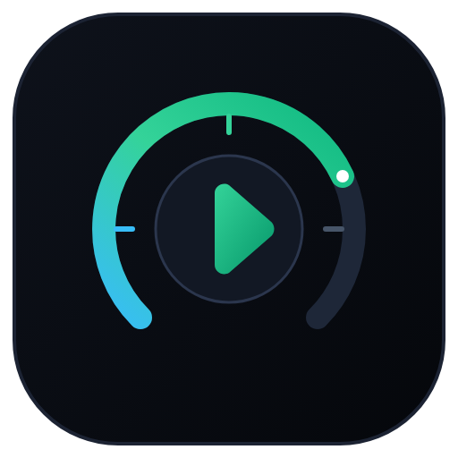
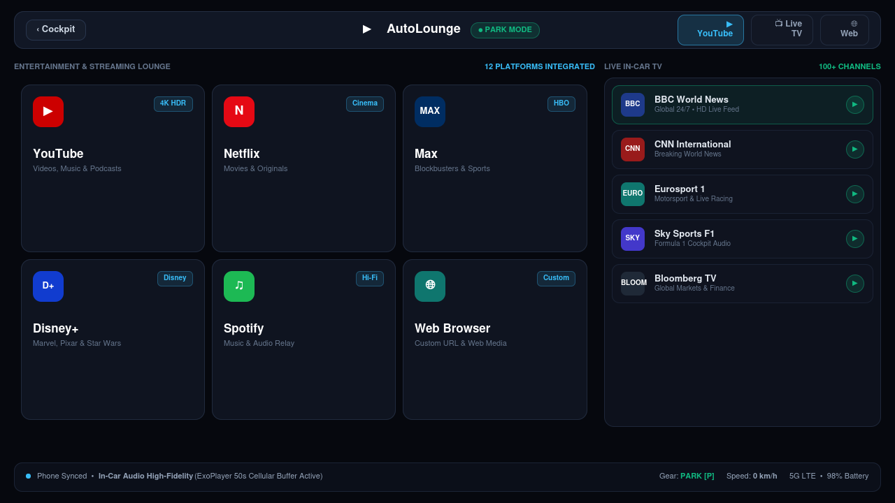
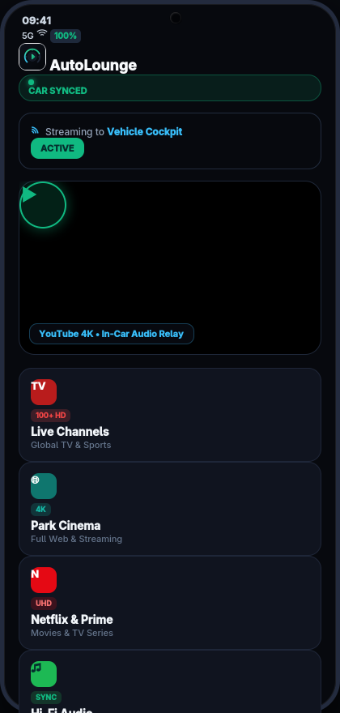

<p align="center">
  
</p>

# 🏎️ AutoLounge — Modern Android Auto Cockpit & Multimedia Lounge

<p align="center">
  <a href="https://github.com/salihoz0/AutoLounge/releases/latest"></a>
  <a href="https://android.com"></a>
  <a href="https://kotlinlang.org"></a>
  <a href="https://developer.android.com/jetpack/compose"></a>
  <a href="#-road-safety--disclaimer"></a>
</p>

<p align="center">
  <a href="#-english"><b>🇬🇧 English</b></a> &nbsp;•&nbsp; <a href="#-türkçe"><b>🇹🇷 Türkçe</b></a>
</p>

---

<a name="-english"></a>
## 🇬🇧 English

### 🌟 What is AutoLounge?

**AutoLounge** is a 100% free, rootless, and open-source Android Auto companion app that transforms your car display into a state-of-the-art cinema and multimedia lounge while parked.

- **Automotive Cockpit UI:** Porsche Taycan and Apple CarPlay-inspired OLED Dark Glass design with large, high-legibility touch targets.
- **YouTube 4K & Global Live TV:** Seamless streaming for video platforms, global news, sports, and web portals directly on your car screen.
- **Rootless & Safe:** No phone rooting, no subscriptions, and zero hidden telemetry.

---

### 📸 Display Mockups

<p align="center">
  <b>Android Auto In-Car Cockpit HUD (1280x720 OLED Glass)</b><br/>
  
</p>

<p align="center">
  <br/>
  <b>Mobile Companion & Settings Manager</b><br/>
  
</p>

---

### ✨ Key Features

| Feature | Description |
| :--- | :--- |
| **📺 YouTube & Live Streams** | Watch YouTube, news broadcasts, sports streams, and web media directly on your car display. |
| **🛡️ Smart Safety Auto-Blanking** | Video renders while the vehicle is in **Park [P]**. When motion is detected, screen blacks out for safety while **audio continues playing uninterrupted**. |
| **⚡ 50s Cellular Buffer** | Optimized media buffering that eliminates dropouts when driving through tunnels or weak cellular zones. |
| **🎛️ Custom Cockpit Tiles (+ Add)** | Pin your favorite web portals, security feeds, or sports streams as one-tap shortcuts to your car screen. |
| **🎨 OLED Interior Themes** | Onyx Emerald, Sapphire Blue, Amethyst, and Cyber Amber palettes matched to your vehicle's ambient lighting. |
| **🔒 100% Free & Open Source** | No trial periods, no license keys, no ads. Built for the community. |

---

### 🚀 Quick Installation (No Root Required)

#### ⚡ Method 1: Instant One-Liner (No repo cloning needed)

Run this single command in your computer terminal with your phone connected via USB:

* **Windows (PowerShell):**
  ```powershell
  curl.exe -sSL -o install.bat https://raw.githubusercontent.com/salihoz0/AutoLounge/main/install.bat; .\install.bat
  ```

* **macOS / Linux (Terminal):**
  ```bash
  curl -fsSL https://raw.githubusercontent.com/salihoz0/AutoLounge/main/install.sh | bash
  ```

---

#### 📦 Method 2: Git Clone (Recommended to Star ⭐ & Contribute)

```bash
git clone https://github.com/salihoz0/AutoLounge.git
cd AutoLounge
```
* **Windows:** Double-click `install.bat`
* **macOS / Linux:** Run `bash install.sh`

---

#### 🛠️ Method 3: Manual ADB Command

If you already have ADB installed and downloaded `AutoLounge.apk`:
```bash
adb install -i "com.android.vending" -r AutoLounge.apk
```
*(The `-i "com.android.vending"` flag marks the app as installed via Google Play Store, which enables full-screen projection on Android Auto without root).*

---

#### 📱 Method 4: PC-Free Installation (KingInstaller)

If you don't have access to a computer:
* **Android 13 and below:** Install [KingInstaller](https://github.com/fcaronte/KingInstaller/releases), select `AutoLounge.apk`, and tap **"Install as Google Play Store"**.
* **Android 14+:** Use [Shizuku](https://shizuku.rikka.app/) paired with KingInstaller.

---

### ⚙️ Phone Setup (2 Quick Steps)

1. **Enable USB Debugging on your phone:**  
   * Go to **Settings → About Phone → Software Information**.  
   * Tap **Build Number** 7 times to enable Developer Mode.  
   * Return to **Settings → Developer Options** and toggle **USB Debugging** ON.  
   *(Xiaomi/Redmi/POCO users: also turn ON "Install via USB" and "USB Debugging (Security settings)").*

2. **Enable Unknown Sources in Android Auto:**  
   * Go to **Settings → Connected Devices → Android Auto**.  
   * Scroll down and tap **Version** 10 times to enable Developer Mode.  
   * Tap the **3 dots (⋮) top-right → Developer settings → Check "Unknown sources"**.

---

### 🛠️ Developer Build

```bash
git clone https://github.com/salihoz0/AutoLounge.git
cd AutoLounge
./gradlew assembleDebug
adb install -i "com.android.vending" -r app/build/outputs/apk/debug/app-debug.apk
```

---

### ⚖️ Road Safety & Disclaimer

* **Driver Responsibility:** AutoLounge is created solely for parked vehicle entertainment and passenger convenience. Driver distraction is dangerous and illegal. Always keep your attention on the road while driving. Use video playback features only when safely parked.

---
---

<a name="-türkçe"></a>
## 🇹🇷 Türkçe

### 🌟 AutoLounge Nedir?

**AutoLounge**, aracınız park halindeyken Android Auto multimedya ekranınızı yeni nesil lüks bir sinema ve eğlence merkezine dönüştüren **%100 ücretsiz, root gerektirmeyen ve açık kaynaklı** bir uygulamadır.

- **Otomotiv Kokpit Arayüzü:** Porsche Taycan ve Apple CarPlay esintili OLED Dark Glass koyu cam tasarımı, yüksek okunurluklu tipografi ve büyük dokunmatik butonlar.
- **YouTube 4K & Canlı TV:** Araç ekranında YouTube videoları, ulusal/uluslararası canlı televizyon kanalları ve web siteleri.
- **Root Gerektirmez:** Telefona root atmaya gerek yoktur, hiçbir abonelik veya gizli ücret içermez.

---

### ✨ Öne Çıkan Özellikler

| Özellik | Açıklama |
| :--- | :--- |
| **📺 YouTube & Canlı TV** | YouTube, canlı haber/spor yayınları ve web portallarını araç ekranında donmadan izleyin. |
| **🛡️ Akıllı Sürüş Güvenliği** | Araç **Park [P]** modundayken video ekranda oynar; araç hareket ettiğinde ekran kararır ve **ses arka planda kesintisiz devam eder**. |
| **⚡ 50s Hücresel Tamponlama** | Tünel geçişlerinde ve zayıf şebeke alanlarında yayının donmasını engelleyen özel tampon profili. |
| **🎛️ Özel Kokpit Kartları (+ Ekle)** | Dilediğiniz web sitesini veya video akışını tek tıkla araç menünüze kısayol kartı olarak ekleyin. |
| **🎨 Kokpit Ambiyans Temaları** | Onyx Emerald, Sapphire Blue, Amethyst ve Cyber Amber renk seçenekleriyle aracınızın iç aydınlatmasına tam uyum. |
| **🔒 %100 Ücretsiz & Açık Kaynak** | Lisans kodu, abonelik veya reklam içermez. |

---

### 🚀 Hızlı Kurulum (Root Gerekmez)

#### ⚡ YOL 1: Tek Satır Otomatik Kurulum (Repoyu klonlamadan)

Telefonunuzu USB kablosuyla bilgisayara bağlayıp bilgisayar terminalinizde şu komutu çalıştırmanız yeterlidir:

* **Windows (PowerShell / CMD):**
  ```powershell
  curl.exe -sSL -o install.bat https://raw.githubusercontent.com/salihoz0/AutoLounge/main/install.bat; .\install.bat
  ```

* **macOS / Linux (Terminal):**
  ```bash
  curl -fsSL https://raw.githubusercontent.com/salihoz0/AutoLounge/main/install.sh | bash
  ```

---

#### 📦 YOL 2: Git ile İndirme (Tavsiye Edilen ⭐)

```bash
git clone https://github.com/salihoz0/AutoLounge.git
cd AutoLounge
```
* **Windows:** Klasördeki `install.bat` dosyasına çift tıklayın.
* **macOS / Linux:** Terminalde `bash install.sh` komutunu çalıştırın.

---

#### 🛠️ YOL 3: Manuel ADB ile Kurulum

Eğer bilgisayarınızda ADB kuruluysa ve `AutoLounge.apk` dosyasını indirdiyseniz:
```bash
adb install -i "com.android.vending" -r AutoLounge.apk
```
*(Buradaki `-i "com.android.vending"` parametresi uygulamayı Google Play Store'dan yüklenmiş olarak tanıtır ve araç ekranında video projeksiyon kilidini root gerekmeden kaldırır).*

---

#### 📱 YOL 4: Bilgisayarsız Kurulum (KingInstaller)

Bilgisayarınız yoksa telefon üzerinden:
* **Android 13 ve altı:** [KingInstaller](https://github.com/fcaronte/KingInstaller/releases) uygulamasını kurup APK'yı seçin ve **"Install as Google Play Store"** seçeneğiyle yükleyin.
* **Android 14 ve üzeri:** [Shizuku](https://shizuku.rikka.app/) + KingInstaller eşleştirmesi ile kurabilirsiniz.

---

### ⚙️ Telefonda Yapılacak 2 Hızlı Ayar

1. **Telefonda USB Hata Ayıklamayı Açın:**
   * **Ayarlar → Telefon Hakkında → Yazılım Bilgileri** bölümüne gidin.
   * **"Yapım Numarası" (Build Number)** yazısına 7 kez dokunarak Geliştirici Seçeneklerini açın.
   * **Ayarlar → Geliştirici Seçenekleri**'ne girip **"USB Hata Ayıklama"**yı açın.  
   *(Xiaomi/Redmi/POCO kullanıcıları: "USB üzerinden yükle" ve "USB Hata Ayıklama (Güvenlik ayarları)" seçeneklerini de mutlaka AÇMALIDIR).*

2. **Android Auto'da "Bilinmeyen Kaynaklar"ı Açın:**
   * **Ayarlar → Bağlı Cihazlar → Android Auto** menüsüne gidin.
   * En alttaki **"Sürüm"** yazısına 10 kez peş peşe dokunarak geliştirici modunu aktif edin.
   * Sağ üstteki **üç nokta (⋮) → Geliştirici Ayarları → "Bilinmeyen kaynaklar" (Unknown sources)** kutusunu işaretleyin.

---

### 🤖 Telefon Modelinize Özel Yapay Zekaya Sorun (Tek Tıkla)

Telefonunuzun marka/modeline göre menü adımlarını bulmak isterseniz aşağıdaki butonlara dokunup modelinizi ekleyerek sorabilirsiniz:

<p align="center">
  <a href="https://chatgpt.com/?q=Android+telefonumda+Android+Auto+i%C3%A7inde+Geli%C5%9Ftirici+Se%C3%A7enekleri+ve+Bilinmeyen+Kaynaklar+(Unknown+sources)+nas%C4%B1l+a%C3%A7%C4%B1l%C4%B1r%3F+Telefon+modelim%3A+" target="_blank">
    
  </a>
  &nbsp;
  <a href="https://claude.ai/new?q=Android+telefonumda+Android+Auto+i%C3%A7inde+Geli%C5%9Ftirici+Se%C3%A7enekleri+ve+Bilinmeyen+Kaynaklar+(Unknown+sources)+nas%C4%B1l+a%C3%A7%C4%B1l%C4%B1r%3F+Telefon+modelim%3A+" target="_blank">
    
  </a>
  &nbsp;
  <a href="https://gemini.google.com/app?q=Android+telefonumda+Android+Auto+i%C3%A7inde+Geli%C5%9Ftirici+Se%C3%A7enekleri+ve+Bilinmeyen+Kaynaklar+(Unknown+sources)+nas%C4%B1l+a%C3%A7%C4%B1l%C4%B1r%3F+Telefon+modelim%3A+" target="_blank">
    
  </a>
</p>

---

### 📜 Sorumluluk Reddi

Bu uygulama araştırma, kişisel araç içi eğlence ve yolcuların kullanımı amacıyla açık kaynak olarak sunulmuştur. Sürüş sırasında video izlemek dikkatinizi dağıtabilir ve trafik kurallarına aykırıdır. Video oynatma özelliğini sadece güvenli park halindeyken veya yolcularınız için kullanınız. Tüm trafik ve sürüş güvenliği sorumluluğu sürücüye aittir.
